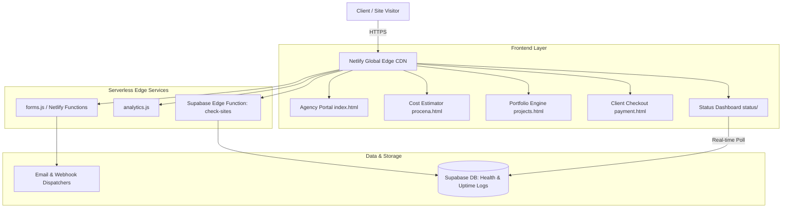

<div align="center">
  <a href="https://milanwebportal.com">
    
  </a>
  <h1>Milan Web Portal</h1>
  <p><b>Flagship digital agency platform, live client portal, automated uptime monitor, and interactive service ecosystem.</b></p>

  <p>
    <a href="https://milanwebportal.com">
      
    </a>
    <a href="https://milanwebportal.com/status/">
      
    </a>
    <a href="https://milanwebportal.com/workflow">
      
    </a>
    <a href="https://milanwebportal.com/procena">
      
    </a>
  </p>

  <p>
    <b>Sub-Second Load Times</b> &bull; <b>Tailwind CSS 3.4</b> &bull; <b>Serverless Edge Functions</b> &bull; <b>Automated Uptime Monitoring</b>
  </p>
</div>

---

## Quick Navigation

- [Overview](#overview)
- [Key Modules & Platforms](#key-modules--platforms)
  - [1. Agency Showcase & Conversion Architecture](#1-agency-showcase--conversion-architecture)
  - [2. Dynamic Projects Portfolio (`projects.html`)](#2-dynamic-projects-portfolio-projectshtml)
  - [3. Interactive Project Cost Estimator (`procena.html`)](#3-interactive-project-cost-estimator-procenal)
  - [4. Client Payment Portal (`payment.html`)](#4-client-payment-portal-paymenthtml)
  - [5. 24/7 Automated Uptime System (`status/`)](#5-247-automated-uptime-system-status)
- [System Architecture](#system-architecture)
- [Tech Stack](#tech-stack)
- [Local Development & Build](#local-development--build)
- [License & Contact](#license--contact)

---

## Overview

**Milan Web Portal** is the central flagship platform for full-stack engineering, digital management, and high-conversion client experiences built by Milan Petkovski. It serves as both a high-traffic production marketing agency portal and an operational hub featuring client payment gateways, dynamic portfolio showcases, instant project cost calculators, and automated 24/7 service monitoring.

The architecture emphasizes sub-second Core Web Vitals, zero bloat, mobile-first responsive interfaces, and clean separation between static delivery and serverless edge automation.

---

## Key Modules & Platforms

### 1. Agency Showcase & Conversion Architecture

- **Home (`index.html`)**: Interactive hero presentation, service catalogs (Custom Web Engineering, SEO & Google Maps Authority, UI/UX Psychology), customer testimonials, and verified technical credentials.
- **Interactive Workflow (`workflow.html`)**: Live visual roadmap illustrating the 5-phase execution model from business discovery to production deployment.

### 2. Dynamic Projects Portfolio (`projects.html`)

- Live filterable case studies categorized across Enterprise, SaaS, E-Commerce, 3D WebGL, and Mobile Platforms.
- Real-time GitHub metadata integration fetching deployment status, metrics, and technology badges.

### 3. Interactive Project Cost Estimator (`procena.html`)

- Multi-step interactive pricing calculator allowing prospective clients to configure target specifications (design tier, backend requirements, integrations, delivery speed).
- Real-time dynamic budget calculations with immediate proposal submission directly into backend webhooks.

### 4. Client Payment Portal (`payment.html`)

- Seamless client checkout hub supporting modern payment methods (Credit Cards, PayPal, Bank Transfers, IPS).
- Automated receipt generation and order verification.

### 5. 24/7 Automated Uptime System (`status/`)

- Public status dashboard providing real-time telemetry on all live production client sites and API services.
- Background health checks powered by Supabase Edge Functions with automatic incident logging and latency metrics.

---

## System Architecture



---

## Tech Stack

| Technology                   | Role                  | Highlights                                                                     |
| :--------------------------- | :-------------------- | :----------------------------------------------------------------------------- |
| **Vite & Vanilla JS**        | Core Engine           | Ultra-fast bundling, minimal JS overhead, and lightning-fast DOM operations.   |
| **Tailwind CSS 3.4**         | Design System         | Fully responsive, custom dark theme tokens, and bespoke glassmorphism effects. |
| **Netlify Edge & Functions** | Hosting & Serverless  | Zero cold-start API endpoints, security headers, and webhook routing.          |
| **Supabase**                 | Cloud Database & Edge | Real-time telemetry, automated status checks, and data persistence.            |

---

## Local Development & Build

### Prerequisites

- **Node.js**: Version 18.x, 20.x, or 22.x LTS
- **npm**: Version 9.x or newer

### Setup

```bash
# Clone the repository
git clone https://github.com/milan-petkovski/Milan-Web-Portal.git
cd Milan-Web-Portal

# Install dependencies
npm install

# Start local development server
npm run dev
```

### Build for Production

```bash
npm run build
```

---

## ☕ The Story & Support

Hi! I am Milan, a 20-year-old student and web developer from Serbia. I founded **Milan Web Portal** to craft high-conversion digital ecosystems, custom web applications, and fast, scalable infrastructure for businesses and creators.

If you appreciate my work, open-source projects, or web tools, and want to support my late-night coding sessions, you can support my work:

- 💖 [Support my work via PayPal](https://paypal.me/milanwebportal)

Every contribution helps me maintain servers, build new open-source initiatives, and push the boundaries of modern web engineering. Thank you!

---

## License & Contact

- **Founder & Lead Developer**: Milan Petkovski
- **Official Website**: [https://milanwebportal.com](https://milanwebportal.com)
- **Direct Inquiries**: `contact@milanwebportal.com`
- **LinkedIn**: [Milan Petkovski](https://linkedin.com/in/milan--petkovski)
- **Support**: 💖 [Support via PayPal](https://paypal.me/milanwebportal)

---

<p align="center">Made with ❤️ by <b>Milan Web Portal</b></p>
